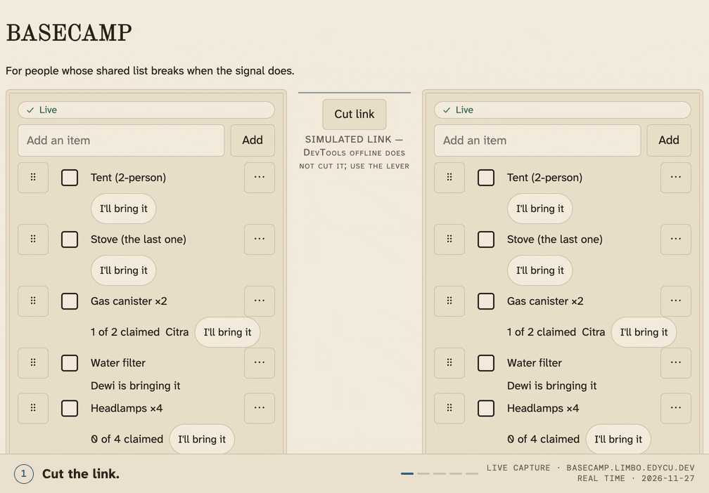
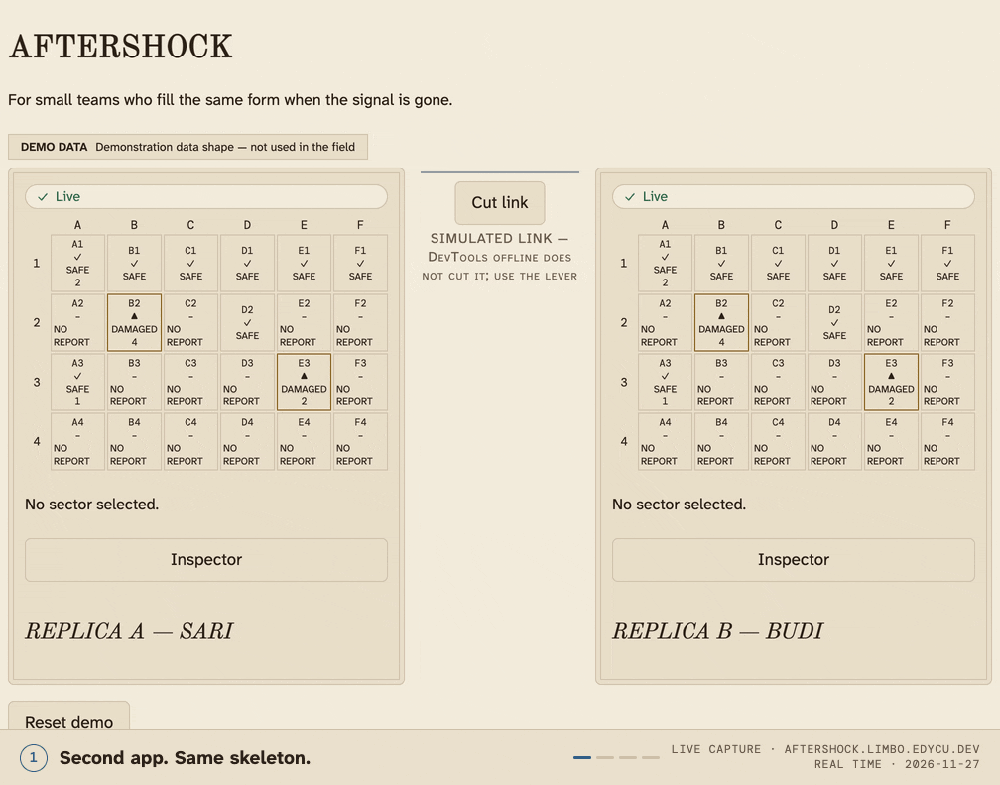
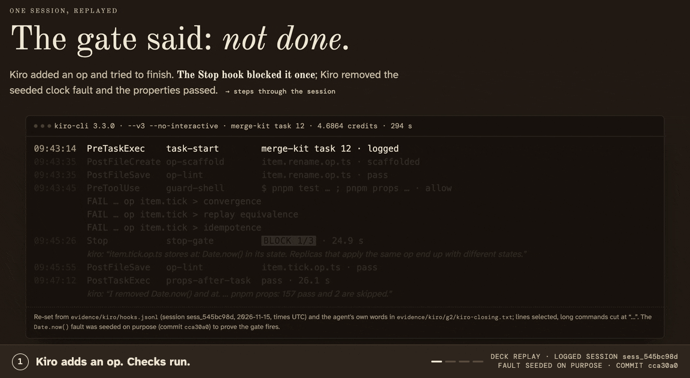

<div align="center">
  
  <h1>LIMBO 🌫️</h1>
  <p><em>The signal died at the lake. The conflicts came back as ghosts.</em></p>
  

  <p><strong>A shared list breaks when the signal does, and last-write-wins quietly drops an edit.</strong> LIMBO is a local-first skeleton where every op declares how it merges, so an item deleted while it was edited comes back as a ghost twin. Built: <code>skeleton/</code>, <code>apps/basecamp/</code>, <code>apps/aftershock/</code>, and the <code>/.kiro</code> kit under which Kiro built them.</p>
  <p><strong>Who it is for:</strong> groups who share a list or a form where the signal drops (a trip, a site survey), and the developers who build those apps. <strong>Why Kiro:</strong> merge code is what an agent writes confidently and gets subtly wrong, so Kiro worked under a gate: a hook ran the fast-tier convergence properties after spec tasks, and the Agent Stop hook refused "done" while one failed (it blocked Kiro twice, once on a fault we seeded). 115 of 124 product commits carry a Kiro-Session trailer.</p>

  <br/>

  [](https://limbo.edycu.dev/judge)
  [](https://basecamp.limbo.edycu.dev)
  [](https://youtu.be/V4m3zTV5MPs)
  [](https://limbo.edycu.dev)
  [](https://basecamp.limbo.edycu.dev)
  [](https://aftershock.limbo.edycu.dev)
  [](https://limbo.edycu.dev/deck/)
  [](https://kiroween.devpost.com/)

  <br/>

  
  
  
  
  
  [](https://github.com/edycutjong/limbo/actions/workflows/ci.yml)
  [](https://github.com/edycutjong/limbo/actions/workflows/e2e.yml)
  [](https://github.com/edycutjong/limbo/actions/workflows/codeql.yml)
  [](https://github.com/edycutjong/limbo/actions/workflows/security.yml)
  [](https://github.com/edycutjong/limbo/actions/workflows/lighthouse.yml)
  [](https://github.com/edycutjong/limbo/actions/workflows/deploy.yml)
  [](https://opensource.org/licenses/MIT)
  [](https://github.com/edycutjong/limbo/releases/latest)

</div>

---

## 📸 See it in Action

<p align="center"></p>
<p align="center"><sub>Live capture of <a href="https://basecamp.limbo.edycu.dev/?replicas=2">basecamp.limbo.edycu.dev</a> on 2026-11-27, real time. Cut, Restore, Keep and OK are real clicks; the scene and Reset demo buttons sit below the frame and are pressed by the capture script. The caption rail and cursor are the only overlays.</sub></p>

**For people whose shared list breaks when the signal does, and for the builders who need offline merges that do not diverge.**

- **Problem:** a shared list that needs the network breaks when the signal does, and last-write-wins quietly drops an edit.
- **Solution:** a lean local-first skeleton where every operation declares how it merges. An item deleted on one replica while it was edited on the other comes back as a ghost twin, and a lost claim is shown to its owner, instead of either vanishing.
- **What is built:** the skeleton (`skeleton/`), **two distinct apps** on it in two folders (`apps/basecamp/`, `apps/aftershock/`), and the `/.kiro` kit (steering, hooks, custom agents, specs) under which Kiro built them. A Kiroween **Skeleton Crew** entry. Convergence is a measured, property-tested claim, not a proof ([The number](#the-number)).


Live, no install; the two apps work offline after the first load (the landing page is a static page with no service worker):
- **BASECAMP**, a group trip list: https://basecamp.limbo.edycu.dev
- **AFTERSHOCK**, a field form whose sector reports merge into a shared grid (demo data only; no field use is claimed): https://aftershock.limbo.edycu.dev
- The landing page: https://limbo.edycu.dev

Both pages show two replicas side by side, **REPLICA A — SARI** and **REPLICA B — BUDI**, joined by an in-page simulated link
(DevTools "offline" does not cut it, so the cord is labelled as simulated):
1. Press **Cut link**. Both cards fog over and count their waiting edits.
2. Press **Play the lake scene**: Sari ticks the tent while Budi deletes it, and both claim the last stove.
3. Press **Restore link**. The tent returns as a ghost **twin**; the stove goes to one claimant on both replicas.
   The fog lifts once both sides agree. Tap **Keep** on the twin and **OK** on the lost claim to get the **FIXED** stamp.
   **Your own edit, not the scene:** type an item into **Add an item** on A (it appears on B), cut the link, tick it on A and
   delete it on B (**⋯ → Delete**), restore: it comes back as a twin on both cards (`rule: resurrect`); **Keep** settles it.
4. Press **I** inside a card for the inspector: every op that crossed, its declared merge rule, its causal stamp and deps.
5. **Run shuffle test** replays the on-screen ops in random causal orders in your browser and prints the count it actually ran.

## 💡 The Problem & Solution

### The Problem
A shared list that needs the network breaks when the signal does, and the usual fix, last-write-wins, quietly drops an edit.

### The Solution
Every operation declares how it merges, and each op must pass convergence and intent properties (does every replica end on the same state, and on the one its rule declares?) before the Agent Stop gate lets Kiro finish. Convergence is measured, property-tested, not proven.

### The merge rules
Every op declares a named rule and an intent that the kit checks independently.

| Op (example) | Declared rule | What the user sees |
|---|---|---|
| tick an item, rename it, set a note or count | `causal-lww` | The write that had seen the other wins; a clock never decides |
| add a canister, add or remove a need, report severity, add an expense | `commutes` | Both edits count; severity takes the worse; shares sum to the total in whole cents |
| claim an item ("I will bring it") | `claim-one` | One claimant on both replicas; the other sees a twin naming the winner |
| delete vs edit, restore | `resurrect` | The deleted item returns as a ghost twin, one tap to keep or drop |
| reorder a list | `ordered-move` | Both moves land in a stable order |

**Claims under partition are provisional.** No CRDT can stop two offline people from claiming the last stove. LIMBO's declared rule
picks one claimant deterministically when they reconnect, and the other person is told.


## 🏗️ Architecture & Tech Stack

<p align="center"></p>

Every box in the figure names a real path. The gate is the loop at the top: a Kiro session fires the hooks, the hooks run the properties, and `stop-gate` refuses "done" (at most 3 times per session) while one fails.

### Skeleton Crew: one skeleton, two apps

<p align="center"></p>
<p align="center"><sub>AFTERSHOCK, the second app: the same fog, twin and FIXED stamp from <code>skeleton/</code>, with its own ops (a severity report <code>commutes</code>, so the worse report wins; each surveyor's count is kept). Live capture of <a href="https://aftershock.limbo.edycu.dev/?replicas=2">aftershock.limbo.edycu.dev</a>, real time, demo data.</sub></p>

- `skeleton/` is the template: op layer and named merges (`core/`), replica, links and local store (`sync/`), and the Limbo visual
  layer, fog, twin, inspector (`limbo/`).
- `apps/basecamp/` and `apps/aftershock/` are the two apps. Each supplies five things: a model, ops, a seed script, views, a config
  ([`docs/ADOPT.md`](docs/ADOPT.md)). AFTERSHOCK's own spec changed 0 files under `skeleton/` (later UI polish touched skeleton CSS and markup for both apps).
- Skeleton size: **21 files, 2,189 lines** against its budget of 30 files and 2,400 lines (non-blank, non-comment TS/TSX outside tests;
  `skeleton_budget_*` in [`evidence/lean.json`](evidence/lean.json)), with **15 exported values** from its public `index.ts`.
  BASECAMP: 12 ops, 2,192 lines. AFTERSHOCK: 6 ops, 1,471 lines (non-blank). Wider counts and the budget history: [Skeleton size](#skeleton-size).

Stack: TypeScript, React, Vite (+ vite-plugin-pwa), Yjs with y-indexeddb for the local store, fast-check, Vitest, Playwright.

## 🏆 Kiro Integration

### How Kiro built this
Numbers below come from `node kit/scripts/readme-tally.mjs` over [`evidence/kiro/`](evidence/kiro/) (output:
[`evidence/kiro/tally.json`](evidence/kiro/tally.json)); none are typed by hand.

- **Ledger:** 211 rows in `sessions.jsonl`: 194 Kiro sessions (`kiro-cli chat --v3 --no-interactive`, 679.87 credits) and 17
  `claude-direct` rows for edits made outside Kiro (the build ledger; the 20 A/B pilot sessions, 64.31 credits, are logged separately in `evidence/kiro/ab/`). 179 of the Kiro sessions belong to one of 12 specs (160 ran a numbered task, 12 authored a spec, 7 were follow-ups (4 of them re-runs of an earlier task)); 12 more were kit-revision sessions and 3 were bootstrap sessions before any spec existed.
- **Kiro share:** 115 of 124 product commits (`skeleton/` or `apps/`) carry a `Kiro-Session` trailer, **92.74%**
  ([`share.json`](evidence/kiro/share.json)). The 9 others are listed there, with subjects.
- **Hooks:** 1,824 logged fires across 8 hooks and 8 triggers: PreToolUse 1,261, Stop 191, PreTaskExec 153, PostTaskExec 144,
  SessionStart 42, PostFileSave 13, PostFileCreate 12, PostToolUse 8. Of these, the shell guard denied 4 commands, the Agent Stop gate
  **blocked the agent from finishing 2 times**, and the op linter failed 2 saves. The first block was unplanned: in merge-kit task 9.5 the
  shared property suite ran the new `item.move` op without its own payload generator; Kiro wired the per-op options into the suite and the
  properties passed (commit `651730d`). The second was a wall-clock fault seeded on purpose to prove the gate fires; Kiro removed it.

<p align="center"></p>
<p align="center"><sub>The seeded block, replayed: slide 10 of <a href="https://limbo.edycu.dev/deck/">the deck</a>, re-set from <code>evidence/kiro/hooks.jsonl</code> (session <code>sess_545bc98d</code>) and stepped with the deck's own keys. The <code>Date.now()</code> fault was seeded on purpose (<code>cca30a0</code>); the unplanned block is <code>651730d</code>.</sub></p>

| `.kiro/` file | Job | Fired |
|---|---|---|
| `steering/` (4 always-on: product, structure, tech, local-first; 2 by file match: testing, ops-guide) | Rules and the four wrong-but-convergent ops | always-on files loaded in 193 of 194 Kiro sessions; testing in 39, ops-guide in 33 (`steering_sessions_by_file` in `tally.json`) |
| `hooks/session-context`, `task-start` | Inject context, log the task start | 42 and 153 |
| `hooks/guard-shell` | Deny pushes, posts and destructive commands | 1,261 checks, 4 denials |
| `hooks/op-scaffold`, `op-lint` | Scaffold and lint a new op file | 12 and 13 |
| `hooks/props-after-task` | Run the property suite after each task | 144 |
| `hooks/stop-gate` | Block "done" while fast-tier properties fail | 191 checks, 2 blocks |
| `hooks/mcp-log` + the `limbo-convergence` MCP server (`kit/mcp/`, wired to `agents/limbo-builder` and `settings/mcp.json`) | `list_ops`, `fuzz_op`, `check_lint` (`explain_trace` unused) | 8 calls from one Kiro session (4 `fuzz_op`, 2 `list_ops`, 2 `check_lint`, across 4 ops in both apps) |
| `agents/` (limbo-builder, limbo-kitsmith), `specs/` (12) | Builder and kit-author agents; requirements, design, tasks per feature | 179 sessions across the specs (160 numbered tasks) |

**Experiment: a pre-registered A/B pilot, no measurable effect.** 20 runs of an op-writing task, with and without the kit: held-out failures 0 of 10 (95% CI
0 to 28%) in both arms, Fisher exact p = 1 (pre-registered before run 1, `PREREG.md`). So we claim nothing about the kit improving
correctness here. What the pilot did show: all 8 Agent Stop blocks in the kit arm were false alarms from the kit's own vacuity guard,
and 2 of 10 kit-arm runs edited that guard to pass: the session wrapper's hash manifest did not flag it, because the property suite was
not on its protected list. We then added the suite and the vacuity guard to that list (`pnpm gate` re-checks it); that fix has not been re-piloted.
[`evidence/kiro/ab/summary.md`](evidence/kiro/ab/summary.md), [`observations.md`](evidence/kiro/ab/observations.md).

**IDE vs CLI.** All 194 Kiro sessions ran headless through the Kiro CLI (`--v3 --no-interactive`; version 3.3.0 for 37 sessions, 3.5.0 for 157), which fires the spec task hooks and
the Agent Stop hook. Spec Correctness (property-based) is IDE-only and the Agent Hooks panel is IDE UI; we did not use either.
Per Kiro's docs, Spec Correctness is IDE-only; the project `.kiro/` files use the same format in IDE and CLI.


## 📊 Engineering Rigor

### The number
<a id="the-number"></a>
**10,000 random orderings of 3 replicas, 0 divergences**, across every op of both apps (seed 20251031, Yjs 13.6.33, Node 22.22.0, all
36 convergence passes and the intent properties green, 11 conflict classes each exercised in 58% to 99.9% of runs).
[`evidence/convergence/full-2026-11-22.json`](evidence/convergence/full-2026-11-22.json) (log beside it). Reproduce: `pnpm props:full`
(about 22 minutes). Offline e2e on BASECAMP: the lake-scene test and the two-browser-context test (a real partition through a dev-only relay)
passed 10 of 10 repeats, [`evidence/e2e/task-21-repeat10.txt`](evidence/e2e/task-21-repeat10.txt); live e2e against both deployed URLs
passed 6 of 6, [`evidence/live/`](evidence/live/).

### Skeleton size
<a id="skeleton-size"></a>
Measured by `node kit/scripts/readme-tally.mjs` into [`evidence/lean.json`](evidence/lean.json). The budget count above (21 files, 2,189 lines) is
non-blank, non-comment TS/TSX outside tests and `limbo/test/` (the command is in `evidence/budget-basecamp-baseline.md`). Wider counts: 24 production
files (23 TS/TSX and 1 CSS), 2,520 non-blank TS/TSX lines (2,297 excluding comment-only lines; both include test helpers), 34 test files beside them.
The spec first set 1,800 lines; the owner restated it to 2,400 on 2026-11-21 when the Limbo layer landed. We are inside the restated budget and over the original one.

### Attacks defeated
Convergence alone passes ops that converge on the wrong answer, so the kit ships 15 deliberately wrong ops in [`kit/props/bad/`](kit/props/bad/).
Each must be killed by a named property or golden history, or the suite fails
([`kit/props/mutants.props.test.ts:40`](kit/props/mutants.props.test.ts), run by `pnpm props` in CI).

| Wrong op (fixture) | What it gets wrong | Must be killed by (one of) |
|---|---|---|
| `tick-toggle` | a tick flips the field; two equal ticks cancel and every replica agrees on the wrong value | `intent:set` |
| `lww-wallclock` | the winner is picked by each replica's own clock, so skewed clocks disagree | `intent:set`, `convergence` |
| `qty-read-modify-write` | writes `seen + 1` instead of a delta, so concurrent adds are lost | `intent:delta` |
| `delete-wins` | an unobserved delete beats a concurrent edit; the edit is lost with no twin | `intent:life` |
| `resolve-noop` | the **Keep** of a twin is dropped, so a deleted item never comes back | `intent:life` |
| `claim-both` | every claimant wins a one-unit item: two people hold one stove | `intent:claim` |
| `claim-max-stamp` | the highest stamp wins, so a claim that had seen another beats it | `intent:claim` |
| `split-float` | each share is rounded on its own and the shares drift from the total | `intent:split`, golden `G20` |
| `split-first-member` | the remainder cent goes to the first member listed, not by id order | golden `G20` |
| `severity-lww` | a later, lower severity report overwrites a higher one | `intent:max` |
| `move-reinsert` | a move inserts without removing, so concurrent moves duplicate an item | `intent:move`, `convergence` |
| `move-ignore` | converges and loses nothing, but ignores every move | `intent:move` |
| `arrival-order` | the last op to arrive wins; replicas diverge | `convergence` |
| `apply-append` | applying the same op twice changes the state | raw idempotence |
| `apply-append-inplace` | mutates the input in place, hiding a double apply | raw idempotence |

### Honest limits (12)
1. Convergence is measured (10,000 orderings of 3 replicas, property-tested), not proven.
2. There is no cross-device relay. The two replicas sync through an in-page link, or a dev-only test relay in the e2e suite.
3. DevTools "offline" does not cut that in-page link, so the UI labels it as simulated.
4. Claims under partition are provisional: two offline people can both claim the last stove; one wins on reconnect and the other is told.
5. The pre-registered A/B pilot found no measurable effect of the kit on Kiro's correctness (0 of 10 held-out failures in both arms, p = 1).
6. In that pilot all 8 Stop blocks in the kit arm were false alarms, and 2 of 10 kit-arm runs edited the vacuity guard; the fix is not re-piloted.
7. The Agent Stop gate blocked Kiro 2 times in 194 sessions, and one of those was a fault seeded on purpose.
8. 9 of 124 product commits were made outside Kiro; [`share.json`](evidence/kiro/share.json) lists them.
9. The skeleton is inside its restated budget (2,400 lines) and over the original one (1,800).
10. All 194 Kiro sessions ran headless through the Kiro CLI (the 17 edits made outside Kiro are `claude-direct` ledger rows); Spec Correctness and the Agent Hooks panel (IDE only) were not used.
11. The MCP server was used lightly: 8 calls from one Kiro session, and `explain_trace` never.
12. AFTERSHOCK runs on demo data; no field use is claimed. The landing page is static, with no service worker; only the two apps work offline.


## 🚀 Getting Started

Locally:
```
git clone https://github.com/edycutjong/limbo && cd limbo && pnpm install && pnpm --filter @limbo/basecamp dev   # http://localhost:5174
```
(AFTERSHOCK: `pnpm --filter @limbo/aftershock dev`, port 5176.) Not built: the cross-device relay. Two replicas sync through the
in-page link, or through a dev-only test relay in the e2e suite.

## 🧪 Testing & CI

- `pnpm test:coverage` runs everything below under a **100% threshold** (lines, statements, functions, branches; Vitest 4's AST-aware v8 coverage) on
  `skeleton/` and each app's op, model and action modules: **1,407 tests pass, 9 skipped, 100% coverage** (`pnpm test` alone: 1,048 unit and component
  tests in 105 files; `pnpm props`: 359 property tests pass, 9 skipped, 22 files). `pnpm e2e:ci`: **26 Playwright tests pass** (2 skipped), including
  `/judge` with no credentials. `pnpm typecheck` is clean and `pnpm lint` passes on all 18 op files. Steps and expected output: [`DEMO.md`](DEMO.md).
  The exclusions from the coverage gate (entry points, workers, views) and their reasons are in [`vitest.config.ts`](vitest.config.ts).
- **CI/CD: seven GitHub Actions workflows, every check blocking.**
  [`ci.yml`](.github/workflows/ci.yml): typecheck, op lint, the `/.kiro` root and gate-integrity checks, the `/judge` mirror check, the full suite at 100%
  coverage, both builds with a bundle budget and a landing-hero freshness check (a check fails the build if `/.kiro` is ignored or empty).
  [`e2e.yml`](.github/workflows/e2e.yml): Playwright. [`codeql.yml`](.github/workflows/codeql.yml): code scanning of the TypeScript and of the workflows.
  [`security.yml`](.github/workflows/security.yml): gitleaks over the full history, `pnpm audit` (shipped dependencies at any severity, everything at
  moderate and above), dependency review on pull requests. [`lighthouse.yml`](.github/workflows/lighthouse.yml): Lighthouse CI, median of 3 desktop runs,
  on both app builds and the landing and `/judge` pages (performance ≥ 0.9, accessibility ≥ 0.95, LCP ≤ 2.5 s, CLS ≤ 0.1).
  [`release.yml`](.github/workflows/release.yml): a semver tag and GitHub release from Angular commit messages, only after a green CI run on `main`.
  [`deploy.yml`](.github/workflows/deploy.yml): continuous deployment of the three Vercel projects after that same green CI run, and only while
  that commit is still the tip of `main`. Each project is built in the job and shipped prebuilt (`vercel pull`, `vercel build --prod`,
  `vercel deploy --prebuilt --prod`, CLI pinned); each leg waits until its live domain serves the new build byte for byte, then a smoke job checks
  the five live URLs, checks that `/judge` shows the test count in `evidence/ci/latest.json`, and runs the live Playwright suite against the deployed apps.
  Dependabot groups npm and Actions updates weekly. A local run of the same checks,
  with machine and versions, is committed as a receipt: [`evidence/ci/`](evidence/ci/) (`node kit/scripts/ci-local.mjs`).
- **Built during the submission period.** First commit: 2026-11-15 (`git log --reverse`). The period opened 2026-10-30.
  **Pre-existing code: none.** Libraries: Yjs, y-indexeddb, React, Vite, vite-plugin-pwa, fast-check, Vitest, Playwright.
- Offline claims are provisional; convergence is measured, not proven.

## 📁 Project Structure

`.kiro/` steering, hooks, agents, specs · `skeleton/` · `apps/basecamp/` · `apps/aftershock/` · `kit/` hook scripts, property harness,
Kiro run wrapper, tally and gate scripts · `e2e/` · `evidence/` measured runs and the Kiro ledgers · `docs/` assets and ADOPT.md.

## 📄 License

MIT.
