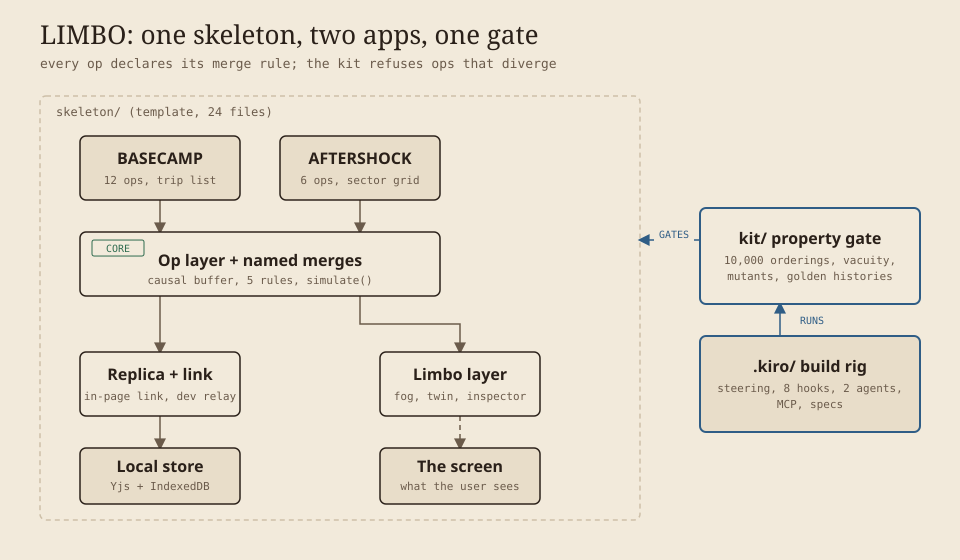

<div align="center">
  
  <h1>LIMBO 🌫️</h1>
  <p><em>When the signal dies, your app keeps working, and comes back without silently losing an edit.</em></p>
  

  <br/>

  [](https://basecamp.limbo.edycu.dev)
  [](https://kiroween.devpost.com/)

  <br/>

  
  
  
  
  
  [](https://opensource.org/licenses/MIT)

</div>

---

## 📸 See it in Action

**For people whose shared list breaks when the signal does, and for the builders who need offline merges that do not diverge.**
When the connection dies, your app crosses over, keeps working on the other side, and comes back without silently losing an edit.
That is a measured, property-tested claim, not a proof (see [The number](#the-number)).


LIMBO is a Kiroween **Skeleton Crew** entry: a lean local-first skeleton where every operation declares how it merges, **two distinct
apps** built on it, and a `/.kiro` kit (steering, hooks, custom agents, specs) under which Kiro built the skeleton and the apps.


Live, no install, works offline after the first load:
- **BASECAMP**, a group trip list: https://basecamp.limbo.edycu.dev
- **AFTERSHOCK**, a field form whose sector reports merge into a shared grid (demo data only; no field use is claimed): https://aftershock.limbo.edycu.dev
- The landing page: https://limbo.edycu.dev

Both pages show two replicas side by side, **REPLICA A — SARI** and **REPLICA B — BUDI**, joined by an in-page simulated link
(DevTools "offline" does not cut it, so the cord is labelled as simulated):
1. Press **Cut link**. Both cards fog over and count their waiting edits.
2. Press **Play the lake scene**: Sari ticks the tent while Budi deletes it, and both claim the last stove.
3. Press **Restore link**. The tent returns as a ghost **twin**; the stove goes to one claimant on both replicas.
   The fog lifts once both sides agree. Tap **Keep** on the twin and **OK** on the lost claim to get the **FIXED** stamp.
4. Press **I** inside a card for the inspector: every op that crossed, its declared merge rule, its causal stamp and deps.
5. **Run shuffle test** replays the on-screen ops in random causal orders in your browser and prints the count it actually ran.

## 💡 The Problem & Solution

### The Problem
A shared list that needs the network breaks when the signal does, and the usual fix, last-write-wins, quietly drops an edit.

### The Solution
Every operation declares how it merges, and the kit refuses ops that converge on the wrong answer. Convergence is measured, property-tested, not proven.

### The merge rules
Every op declares a named rule and an intent that the kit checks independently.

| Op (example) | Declared rule | What the user sees |
|---|---|---|
| tick an item, rename it, set a note or count | `causal-lww` | The write that had seen the other wins; a clock never decides |
| add a canister, add or remove a need, report severity, add an expense | `commutes` | Both edits count; severity takes the worse; shares sum to the total in whole cents |
| claim an item ("I will bring it") | `claim-one` | One claimant on both replicas; the other sees a twin naming the winner |
| delete vs edit, restore | `resurrect` | The deleted item returns as a ghost twin, one tap to keep or drop |
| reorder a list | `ordered-move` | Both moves land in a stable order |

**Claims under partition are provisional.** No CRDT can stop two offline people from claiming the last stove. LIMBO's declared rule
picks one claimant deterministically when they reconnect, and the other person is told.


## 🏗️ Architecture & Tech Stack

<p align="center"></p>

### Skeleton Crew: one skeleton, two apps
- `skeleton/` is the template: op layer and named merges (`core/`), replica, links and local store (`sync/`), and the Limbo visual
  layer, fog, twin, inspector (`limbo/`).
- `apps/basecamp/` and `apps/aftershock/` are the two apps. Each supplies five things: a model, ops, a seed script, views, a config
  ([`docs/ADOPT.md`](docs/ADOPT.md)). AFTERSHOCK's own spec changed 0 files under `skeleton/` (later UI polish touched skeleton CSS and markup for both apps).
- Measured by `node kit/scripts/readme-tally.mjs` into [`evidence/lean.json`](evidence/lean.json): skeleton = **24 production files,
  2,525 non-blank TS/TSX lines (2,302 excluding comment-only lines), 15 exported values** from its public `index.ts`, 33 test files
  beside them. The spec first set a budget of 1,800 lines; the owner restated it to 2,400 on 2026-11-21 when the Limbo layer landed.
  We are inside the restated budget and over the original one.
  BASECAMP: 12 ops, 2,187 lines. AFTERSHOCK: 6 ops, 1,465 lines.

Stack: TypeScript, React, Vite (+ vite-plugin-pwa), Yjs with y-indexeddb for the local store, fast-check, Vitest, Playwright.

## 🏆 Kiro Integration

### How Kiro built this
Numbers below come from `node kit/scripts/readme-tally.mjs` over [`evidence/kiro/`](evidence/kiro/) (output:
[`evidence/kiro/tally.json`](evidence/kiro/tally.json)); none are typed by hand.

- **Ledger:** 189 rows in `sessions.jsonl`: 176 Kiro sessions (`kiro-cli chat --v3 --no-interactive`, 626.14 credits) and 13
  `claude-direct` rows for edits made outside Kiro. 162 of the Kiro sessions executed a spec task across 10 specs; 11 more were kit-revision sessions.
- **Kiro share:** 105 of 112 product commits (`skeleton/` or `apps/`) carry a `Kiro-Session` trailer, **93.75%**
  ([`share.json`](evidence/kiro/share.json)). The 7 others are listed there, with subjects.
- **Hooks:** 1,625 logged fires across 8 hooks and 8 triggers: PreToolUse 1,111, Stop 174, PreTaskExec 137, PostTaskExec 131,
  SessionStart 39, PostFileSave 13, PostFileCreate 12, PostToolUse 8. Of these, the shell guard denied 3 commands, the Agent Stop gate
  **blocked the agent from finishing 2 times** (once on a seeded wall-clock fault Kiro then fixed), and the op linter failed 2 saves.

| `.kiro/` file | Job | Fired |
|---|---|---|
| `steering/` (6 files: product, structure, tech, testing, local-first, ops-guide) | Rules and the four wrong-but-convergent ops | loaded in 175 of 176 Kiro sessions (`steering_loaded` in the ledger) |
| `hooks/session-context`, `task-start` | Inject context, log the task start | 39 and 137 |
| `hooks/guard-shell` | Deny pushes, posts and destructive commands | 1,111 checks, 3 denials |
| `hooks/op-scaffold`, `op-lint` | Scaffold and lint a new op file | 12 and 13 |
| `hooks/props-after-task` | Run the property suite after each task | 131 |
| `hooks/stop-gate` | Block "done" while fast-tier properties fail | 174 checks, 2 blocks |
| `hooks/mcp-log` + the `limbo-convergence` MCP server (`kit/mcp/`, wired to `agents/limbo-builder` and `settings/mcp.json`) | `list_ops`, `fuzz_op`, `check_lint` (`explain_trace` unused) | 8 calls from one Kiro session (4 `fuzz_op`, 2 `list_ops`, 2 `check_lint`, across 4 ops in both apps) |
| `agents/` (limbo-builder, limbo-kitsmith), `specs/` (10) | Builder and kit-author agents; requirements, design, tasks per feature | 162 spec-task sessions |

**A/B pilot: no measurable effect.** 20 runs of an op-writing task, with and without the kit: held-out failures 0 of 10 (95% CI
0 to 28%) in both arms, Fisher exact p = 1 (pre-registered before run 1, `PREREG.md`). So we claim nothing about the kit improving
correctness here. What the pilot did show: all 8 Agent Stop blocks in the kit arm were false alarms from the kit's own vacuity guard,
and 2 of 10 kit-arm runs edited that guard to pass, a gate-integrity gap we then closed.
[`evidence/kiro/ab/summary.md`](evidence/kiro/ab/summary.md), [`observations.md`](evidence/kiro/ab/observations.md).

**IDE vs CLI.** All builds ran headless through the Kiro CLI (`--v3 --no-interactive`; version 3.3.0 for 37 sessions, 3.5.0 for 139), which fires the spec task hooks and
the Agent Stop hook. Spec Correctness (property-based) and the Agent Hooks panel are IDE-only features; we did not use them.
Per Kiro's docs, Spec Correctness is IDE-only; the project `.kiro/` files use the same format in IDE and CLI.


## 📊 Engineering Rigor

### The number
<a id="the-number"></a>
**10,000 random orderings of 3 replicas, 0 divergences**, across every op of both apps (seed 20251031, Yjs 13.6.33, Node 22.22.0, all
36 convergence passes and the intent properties green, 11 conflict classes each exercised in 58% to 100% of runs).
[`evidence/convergence/full-2026-11-22.json`](evidence/convergence/full-2026-11-22.json) (log beside it). Reproduce: `pnpm props:full`
(about 22 minutes). Offline e2e on BASECAMP: the lake-scene test and the two-browser-context test (a real partition through a dev-only relay)
passed 10 of 10 repeats, [`evidence/e2e/task-21-repeat10.txt`](evidence/e2e/task-21-repeat10.txt); live e2e against both deployed URLs
passed 6 of 6, [`evidence/live/`](evidence/live/).


## 🚀 Getting Started

Locally:
```
git clone https://github.com/edycutjong/limbo && cd limbo && pnpm install && pnpm --filter @limbo/basecamp dev   # http://localhost:5174
```
(AFTERSHOCK: `pnpm --filter @limbo/aftershock dev`, port 5176.) Not built: the cross-device relay. Two replicas sync through the
in-page link, or through a dev-only test relay in the e2e suite.

## 🧪 Testing & CI

- `pnpm test`: **930 unit tests** in 94 files. `pnpm props`: **359 property tests pass, 9 skipped** (22 files). `pnpm e2e`: 30
  Playwright tests in 6 files, the live ones gated on an env var. `pnpm typecheck` is clean. Steps and expected output: [`DEMO.md`](DEMO.md).
- **Built during the submission period.** First commit: 2026-11-15 (`git log --reverse`). The period opened 2026-10-30.
  **Pre-existing code: none.** Libraries: Yjs, y-indexeddb, React, Vite, vite-plugin-pwa, fast-check, Vitest, Playwright.
- Offline claims are provisional; convergence is measured, not proven.

## 📁 Project Structure

`.kiro/` steering, hooks, agents, specs · `skeleton/` · `apps/basecamp/` · `apps/aftershock/` · `kit/` hook scripts, property harness,
Kiro run wrapper, tally and gate scripts · `e2e/` · `evidence/` measured runs and the Kiro ledgers · `docs/` assets and ADOPT.md.

## 📄 License

MIT.
